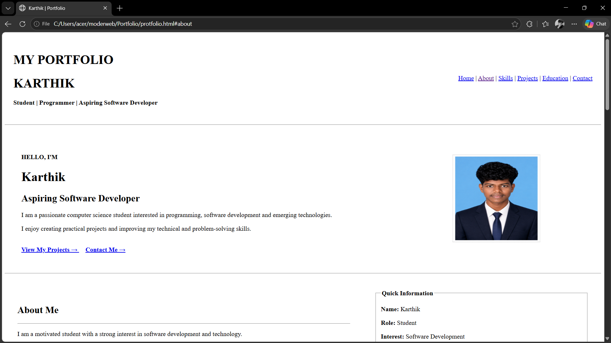

# Ex01 Portfolio
## Date:

## AIM
To create a Portfolio using HTML and CSS.

## ALGORITHM
### STEP 1
Create an HTML file (index.html)

### STEP 2
Create a CSS file (style.css)

### STEP 3
Include a navigation bar with links to different sections.

### STEP 4
Add structured sections for introduction, about, projects, and contact details.

### STEP 5
Define global styles for fonts, colors, and layout.

### STEP 6
Style the header, navigation bar, and sections.

### STEP 7
Use Flexbox or CSS Grid for layout design.

### STEP 8
Add hover effects and transitions for interactivity.

### STEP 9
Add Images and Media.

### STEP 10
Use optimized images for a professional look.

### STEP 11
Open the HTML file in a browser to check layout and functionality.

### STEP 12
Fix styling issues and refine content placement.

### STEP 13
Deploy the Portfolio.

### STEP 14
Upload to GitHub Pages for free hosting.

## PROGRAM
```
<!DOCTYPE html>
<html lang="en">

<head>
    <meta charset="UTF-8">
    <meta name="viewport" content="width=device-width, initial-scale=1.0">
    <title>Karthik | Portfolio</title>
</head>

<body>

    <title>My Professional Portfolio</title>

    <header>

        <table width="100%" cellpadding="20">

            <tr>

                <td>
                    <h1>MY PORTFOLIO</h1>
               
                    <h1>KARTHIK</h1>
                    <p>
                        <b>Student | Programmer | Aspiring Software Developer</b>
                    </p>
                </td>

                <td align="right">

                    <nav>

                        <a href="#home">Home</a> |
                        <a href="#about">About</a> |
                        <a href="#skills">Skills</a> |
                        <a href="#projects">Projects</a> |
                        <a href="#education">Education</a> |
                        <a href="#contact">Contact</a>

                    </nav>

                </td>

            </tr>

        </table>

        <hr>

    </header>


    <!-- ================= HOME ================= -->

    <section id="home">

        <table width="100%" cellpadding="40">

            <tr>

                <td width="65%">

                    <h4>HELLO, I'M</h4>

                    <h1>Karthik</h1>

                    <h2>Aspiring Software Developer</h2>

                    <p>
                        I am a passionate computer science student interested
                        in programming, software development and emerging
                        technologies.
                    </p>

                    <p>
                        I enjoy creating practical projects and improving
                        my technical and problem-solving skills.
                    </p>

                    <br>

                    <a href="#projects">
                        <b>View My Projects →</b>
                    </a>

                    &nbsp;&nbsp;&nbsp;

                    <a href="#contact">
                        <b>Contact Me →</b>
                    </a>

                </td>


                <td width="35%" align="center">

                    

                </td>

            </tr>

        </table>

    </section>

    <hr>


    <!-- ================= ABOUT ================= -->

    <section id="about">

        <table width="100%" cellpadding="30">

            <tr>

                <td width="60%">

                    <h2>About Me</h2>

                    <hr>

                    <p>
                        I am a motivated student with a strong interest in
                        software development and technology.
                    </p>

                    <p>
                        I like learning new programming concepts and applying
                        them through practical projects.
                    </p>

                    <p>
                        My areas of interest include web development,
                        programming, databases, artificial intelligence
                        and problem solving.
                    </p>

                </td>


                <td width="40%">

                    <fieldset>

                        <legend>
                            <b>Quick Information</b>
                        </legend>

                        <p><b>Name:</b> Karthik</p>

                        <p><b>Role:</b> Student</p>

                        <p>
                            <b>Interest:</b>
                            Software Development
                        </p>

                        <p>
                            <b>Location:</b>
                            Tamil Nadu, India
                        </p>

                        <p>
                            <b>Languages:</b>
                            English, Tamil
                        </p>

                    </fieldset>

                </td>

            </tr>

        </table>

    </section>

    <hr>


    <!-- ================= SKILLS ================= -->

    <section id="skills">

        <table width="100%" cellpadding="30">

            <tr>

                <td>

                    <h2>Technical Skills</h2>

                    <hr>

                    <table
                        width="100%"
                        border="1"
                        cellpadding="15"
                    >

                        <tr>

                            <th>Skill</th>
                            <th>Level</th>
                            <th>Area</th>

                        </tr>

                        <tr>

                            <td>C Programming</td>
                            <td>Intermediate</td>
                            <td>Programming</td>

                        </tr>

                        <tr>

                            <td>Python</td>
                            <td>Intermediate</td>
                            <td>Programming</td>

                        </tr>

                        <tr>

                            <td>Java</td>
                            <td>Beginner</td>
                            <td>Programming</td>

                        </tr>

                        <tr>

                            <td>HTML</td>
                            <td>Intermediate</td>
                            <td>Web Development</td>

                        </tr>

                        <tr>

                            <td>SQL</td>
                            <td>Intermediate</td>
                            <td>Database</td>

                        </tr>

                        <tr>

                            <td>Git & GitHub</td>
                            <td>Intermediate</td>
                            <td>Version Control</td>

                        </tr>

                    </table>

                </td>

            </tr>

        </table>

    </section>

    <hr>


    <!-- ================= PROJECTS ================= -->

    <section id="projects">

        <table width="100%" cellpadding="30">

            <tr>

                <td colspan="3">

                    <h2>Featured Projects</h2>

                    <hr>

                </td>

            </tr>


            <tr>

                <!-- PROJECT 1 -->

                <td width="33%" valign="top">

                    <fieldset>

                        <legend>
                            <b>PROJECT 01</b>
                        </legend>

                        <h3>Personal Portfolio</h3>

                        <p>
                            A professional portfolio website designed to
                            showcase my skills, projects, education and
                            contact information.
                        </p>

                        <p>
                            <b>Technology:</b> HTML
                        </p>

                    </fieldset>

                </td>


                <!-- PROJECT 2 -->

                <td width="33%" valign="top">

                    <fieldset>

                        <legend>
                            <b>PROJECT 02</b>
                        </legend>

                        <h3>Restaurant Website</h3>

                        <p>
                            A restaurant website containing food menus,
                            food items, administration details and
                            contact information.
                        </p>

                        <p>
                            <b>Technology:</b> HTML
                        </p>

                    </fieldset>

                </td>


                <!-- PROJECT 3 -->

                <td width="33%" valign="top">

                    <fieldset>

                        <legend>
                            <b>PROJECT 03</b>
                        </legend>

                        <h3>Railway Navigation System</h3>

                        <p>
                            A smart navigation concept designed to help
                            passengers locate important facilities inside
                            railway stations.
                        </p>

                        <p>
                            <b>Area:</b> AI & Navigation
                        </p>

                    </fieldset>

                </td>

            </tr>

        </table>

    </section>

    <hr>


    <!-- ================= EDUCATION ================= -->

    <section id="education">

        <table width="100%" cellpadding="30">

            <tr>

                <td>

                    <h2>Education</h2>

                    <hr>

                    <table
                        width="100%"
                        border="1"
                        cellpadding="15"
                    >

                        <tr>

                            <th>Qualification</th>
                            <th>Institution</th>
                            <th>Year</th>
                            <th>Status</th>

                        </tr>

                        <tr>

                            <td>Undergraduate Degree</td>

                            <td>
                                Saveetha Engineering College
                            </td>

                            <td>2025 - Present</td>

                            <td>
                                <b>Currently Studying</b>
                            </td>

                        </tr>

                        <tr>

                            <td>Higher Secondary</td>

                            <td>School</td>

                            <td>2025</td>

                            <td>Completed</td>

                        </tr>

                    </table>

                </td>

            </tr>

        </table>

    </section>

    <hr>


    <!-- ================= CERTIFICATIONS ================= -->

    <section>

        <table width="100%" cellpadding="30">

            <tr>

                <td>

                    <h2>Certifications & Activities</h2>

                    <hr>

                    <ul>

                        <li>
                            Programming and coding workshops
                        </li>

                        <li>
                            Technical seminars and workshops
                        </li>

                        <li>
                            Hackathon participation
                        </li>

                        <li>
                            Web development projects
                        </li>

                        <li>
                            Programming challenges
                        </li>

                    </ul>

                </td>

            </tr>

        </table>

    </section>

    <hr>


    <!-- ================= CAREER OBJECTIVE ================= -->

    <section>

        <table width="100%" cellpadding="30">

            <tr>

                <td align="center">

                    <h2>Career Objective</h2>

                    <p>
                        <i>
                            "To become a skilled software developer by
                            continuously learning new technologies,
                            developing innovative solutions and
                            contributing to meaningful real-world projects."
                        </i>
                    </p>

                </td>

            </tr>

        </table>

    </section>

    <hr>


    <!-- ================= CONTACT ================= -->

    <section id="contact">

        <table width="100%" cellpadding="30">

            <tr>

                <td width="50%" valign="top">

                    <h2>Get In Touch</h2>

                    <hr>

                    <p>
                        <b>Email:</b>
                        <a href="mailto:karthik171120072008@gmail.com">
                            karthik171120072008@gmail.com
                        </a>
                    </p>

                    <p>
                        <b>Phone:</b>
                        +91 6383016619
                    </p>

                    <p>
                        <b>GitHub:</b>
                        <a
                            href="https://github.com/karthikj757"
                            target="_blank"
                        >
                            https://github.com/karthikj757
                        </a>
                    </p>

                    <p>
                        <b>LinkedIn:</b>
                        <a
                            href="https://www.linkedin.com/in/karthik-j-51748b381"
                            target="_blank"
                        >
                            https://www.linkedin.com/in/karthik-j-51748b381
                        </a>
                    </p>

                </td>


                <td width="50%" valign="top">

                    <fieldset>

                        <legend>
                            <b>Send Me a Message</b>
                        </legend>

                        <form>

                            <label>
                                <b>Name</b>
                            </label>

                            <br>

                            <input
                                type="text"
                                name="name"
                                size="40"
                                required
                            >

                            <br><br>


                            <label>
                                <b>Email</b>
                            </label>

                            <br>

                            <input
                                type="email"
                                name="email"
                                size="40"
                                required
                            >

                            <br><br>


                            <label>
                                <b>Message</b>
                            </label>

                            <br>

                            <textarea
                                name="message"
                                rows="6"
                                cols="40"
                            ></textarea>

                            <br><br>

                            <input
                                type="submit"
                                value="Send Message"
                            >

                            &nbsp;

                            <input
                                type="reset"
                                value="Clear"
                            >

                        </form>

                    </fieldset>

                </td>

            </tr>

        </table>

    </section>


    <!-- ================= FOOTER ================= -->

    <footer>

        <hr>

        <table width="100%" cellpadding="20">

            <tr>

                <td align="center">

                    <h3>KARTHIK</h3>

                    <p>
                        Aspiring Software Developer
                    </p>

                    <p>
                        <a href="#home">
                            Back to Top ↑
                        </a>
                    </p>

                    <hr>

                    <p>
                        &copy; 2026 Karthik. All Rights Reserved.
                    </p>

                </td>

            </tr>

        </table>

    </footer>

</body>

</html>
```

## OUTPUT



## RESULT
The program for creating Portfolio using HTML and CSS is executed successfully.
